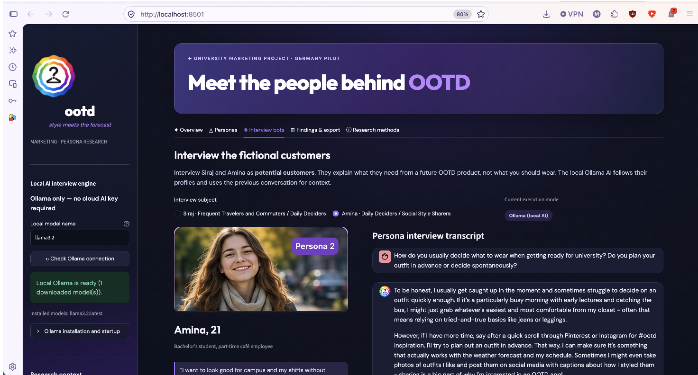
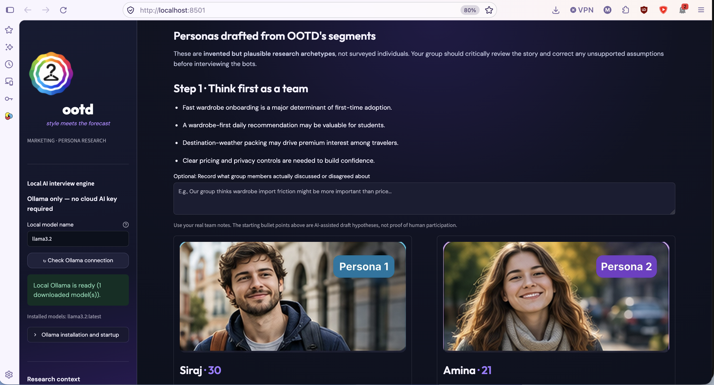
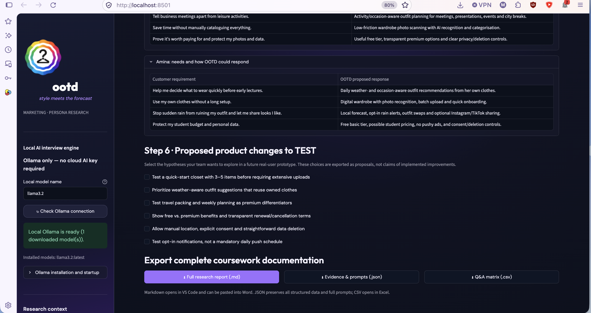
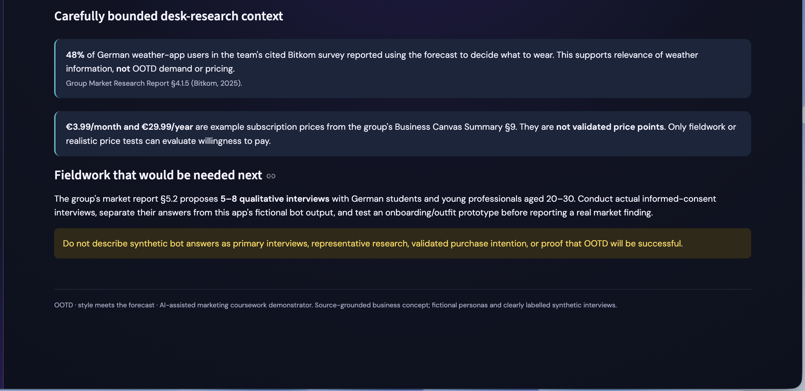

# OOTD Persona Research Lab

A Streamlit web application for AI-assisted customer persona research. It creates two fictional customer personas for **OOTD**, a proposed weather-aware outfit app for the German market, and lets you interview them through a **local Ollama language model**. Every step is documented and can be exported for coursework.

🔗 **Live demo:** https://ootd-persona-lab.streamlit.app

> Hosted on Streamlit Community Cloud. If the app has been asleep, click **"Yes, get this app back up!"** and wait a few seconds.
> **Note:** the live interview bots need Ollama running on your own computer, so they **don't work in the online demo**. You can still browse the personas, load the 22 example Q&A pairs in *Findings & export*, and download every report. To interview the bots yourself, run the app locally (see below).



## What it does

The app follows a six-step research workflow:

| Step | What happens in the app |
|---|---|
| 1. Human-first thinking | The team reviews draft hypotheses, records its own discussion, edits each persona and confirms that a human has reviewed it |
| 2. Two personas | **Siraj** (a professional who travels) and **Amina** (a student), each with their own goals, budget, pain points and objections |
| 3. Persona portraits | AI-generated fictional portraits, clearly labelled as fictional |
| 4. Reusable persona bots | Each persona's profile is locked into a system prompt you can inspect, and a local Ollama model plays the persona |
| 5. Structured interviews | 18 guided questions on daily routines, weather, onboarding, features, free vs. premium pricing, ads and privacy, plus free-text questions |
| 6. Documentation | Evidence matrix, needs → feature mapping, a decision log of proposed changes to test, and exports in Markdown, JSON and CSV |

All interview answers are **synthetic**. The app labels them clearly and never presents them as real customer evidence.

## App sections

- **Overview:** the OOTD proposition, the proposed customer journey and the persona cards
- **Personas:** full profiles, a team discussion box, editable notes and a review checkbox
- **Interview bots:** guided or free-text interviews with an inspectable system prompt
- **Findings & export:** evidence matrix, hypotheses, needs → features, decision checklist and downloads
- **Research methods:** method, source traceability and limitations of the desk research

## Run it locally (needed for the interview bots)

1. Install [Ollama](https://ollama.com/download) and open it.
2. Download the model:
   ```bash
   ollama pull llama3.2
   ```
3. Clone this repository and install the dependencies:
   ```bash
   git clone https://github.com/mdzamirhossain/ootd-persona-research-lab.git
   cd ootd-persona-research-lab
   python -m pip install -r requirements.txt
   ```
4. Start the app:
   ```bash
   python -m streamlit run app.py
   ```
5. Your browser opens at `http://localhost:8501`. The sidebar should show a green Ollama connection message.

If Ollama is installed but not responding, run `ollama serve` in a separate terminal and leave it open.

## Project structure

```
app.py             Streamlit interface (tabs, interview flow, exports)
persona_data.py    Personas, question bank, hypotheses, needs → features, sources
persona_engine.py  System prompt builder, question classifier, Ollama connection
reporting.py       Evidence matrix, sample interviews, Markdown/JSON/CSV export
assets/            OOTD badge and persona portraits
screenshots/       Images used in this README
requirements.txt   Python dependencies
```

## Tech stack

Python · Streamlit · Ollama (local LLM, default `llama3.2`)

## Limitations

- The personas are invented archetypes, not surveyed individuals.
- Bot answers are AI-generated and don't show real demand, willingness to pay or purchase intention.
- €3.99/month and €29.99/year are example prices, not validated price points.
- Before drawing any market conclusion, real informed-consent interviews with 5–8 German students and young professionals are needed.

## Screenshots

| Personas | Interview bots |
|---|---|
|  |  |

| Findings & export | Research methods |
|---|---|
|  |  |

## Context

Built as part of the M.Sc. module **AI-Driven Supply Chain Management** at Hof University of Applied Sciences. The project explores how locally run generative AI can support early-stage customer and demand research while keeping a human in the loop and every step documented.
